# 拆一只飞利浦 USB 插排：为了底部那块凸起

家里这只飞利浦插排用了几年，一直是床头主力：一个总控开关、两个插孔位、外加三个 USB 口。前阵子把它翻过来擦灰，发现底盖上有一块说不清来历的凸起——就是我拇指按住的那个位置。塑料壳本身挺硬，可凸起正好落在插孔和内部铜条所在的那一面，心里就有点打鼓：别是里面的元件老化发热，把壳给顶起来了。这点疑虑搁了半个多月，今天干脆拆开看看。

全程断电操作，插头拔下来才动手。

## 1 底部那块凸起

### 1.1 先认一下这只插排

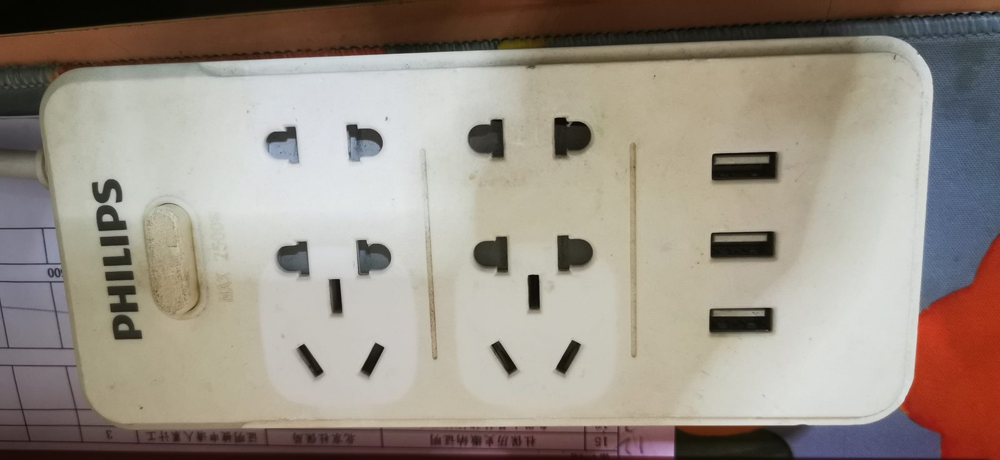

**图 1.1.1 插排正面**（左边总控开关，中间两个插孔位，右边三个 USB 口）

正面没什么玄机，一体成型的白色塑料，插孔是两孔三孔都能插的组合孔，铭牌上标着 MAX 2500W、USB 输出 5V/2.4A。日常它就是给手机、台灯、路由器供电，没什么大功率负载。

### 1.2 从外面看不出来

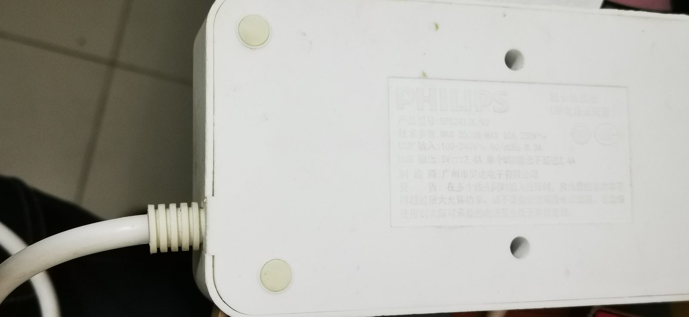

**图 1.2.1 底盖全貌**（这张是 10 月 12 日拍的，那时已经在琢磨它了）

我要找的凸起就在这一面上，在底盖中部，用手按下去没有回弹，也不像是塑料件本身的造型。光从外面判断不了成因，只能拆。

## 2 两颗三角螺丝

### 2.1 底部一眼能看到两颗螺丝

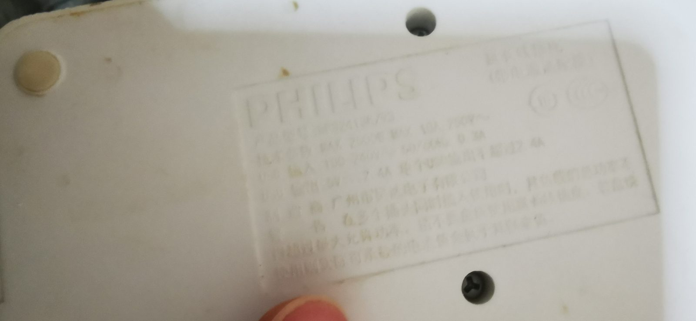

**图 2.1.1 底盖上裸着的两颗三角螺丝**

这两颗没做任何遮蔽，缺点是防不住人，优点是省事。槽是三瓣的三角（也有人叫 Y 型），跟常见的十字完全不是一回事，用十字螺丝刀硬怼只会把槽怼花。

### 2.2 恰好有一把能用的批头

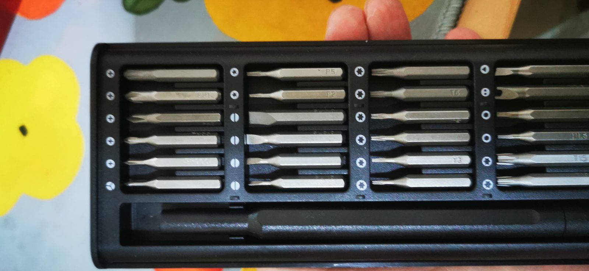

**图 2.2.1 精密批头套装**（三瓣的三角批头就藏在里面）

手边这套精密批头里正好有三个瓣的那种刀头，换上之后拧两下，两颗螺丝都下来了。顺一句：三角螺丝看着唬人，其实就是标准件，成套批头里基本都带，碰上了不用专门买。

## 3 后盖不松口，脚垫下面还藏着四颗

### 3.1 两颗螺丝拧完，还是掰不开

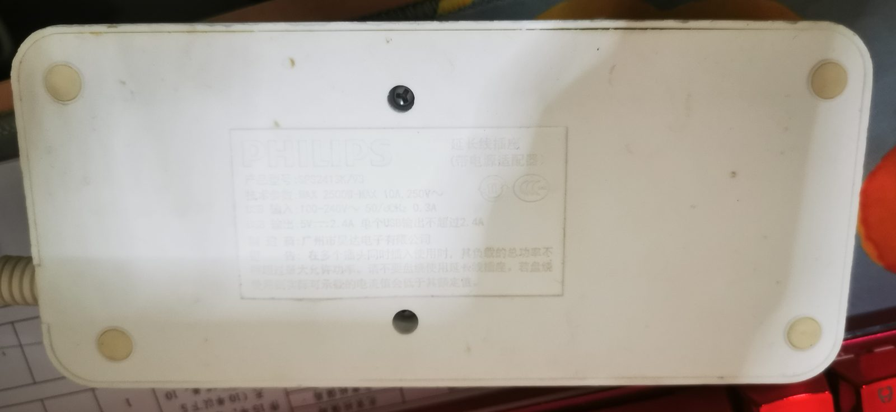

**图 3.1.1 四个脚垫和两个已拧掉螺丝的孔位**

按经验两颗螺丝就该开了，结果用手掰了半天，后盖一条缝都不给。那就得看别处——四角的脚垫太规整，藏在下面的可能性最大。

### 3.2 撬开才知道是胶帽

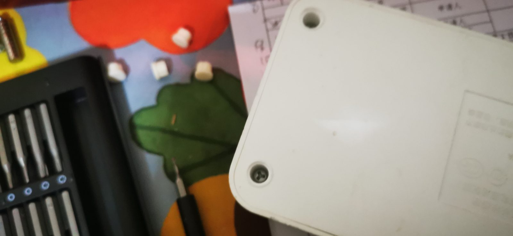

**图 3.2.1 撬下来的四只胶帽**

换成一字螺丝刀，从脚垫边缘插进去一撬，才发现这玩意儿不是粘死的脚垫，而是一只胶帽：底下是空的，专门用来盖螺丝孔。四只胶帽收得都很规整，材质还有点弹性，这点心思花得挺细。底下四颗螺丝拧下来，后盖就轻松打开了。

## 4 里面到底装了什么

### 4.1 掀开先看到的是一排铜条

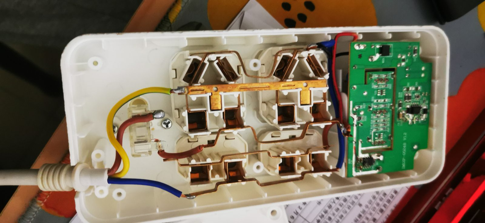

**图 4.1.1 内部全貌**（整排铜条、三芯电源线，进线端用热缩管收口）

内部比我预想的简单：没有电路板铺满，主要就是几条铜条顺着插孔排下去，把火线、零线、地线送到每个孔位。

这几条铜线目测也就 1 平方毫米出头，说实话比我想的细。铭牌写的是 2500W，满载算下来 11 A 出头，1 平方的铜长期扛这个电流谈不上宽裕——平时充手机、带台灯当然没问题，但别指望它长期带大功率电器。

### 4.2 凸起那里什么都没有，元件都在 USB 那一头

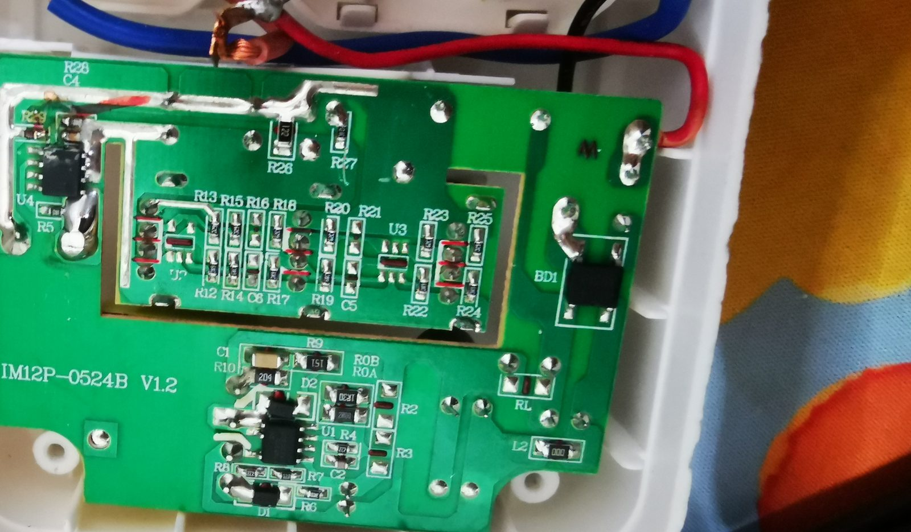

**图 4.2.1 USB 供电板全貌**（一块开关电源板，输出侧接着三个 USB 母座）

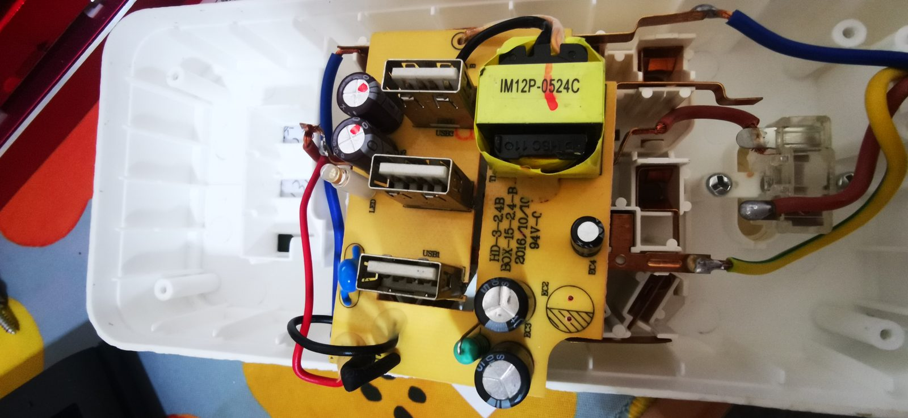

**图 4.2.2 USB 模块背面一览**

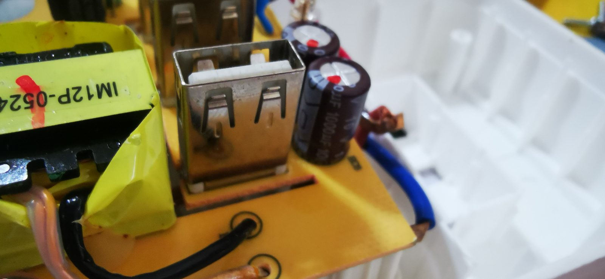

**图 4.2.3 变压器、USB 母座与 1000 µF 电容**

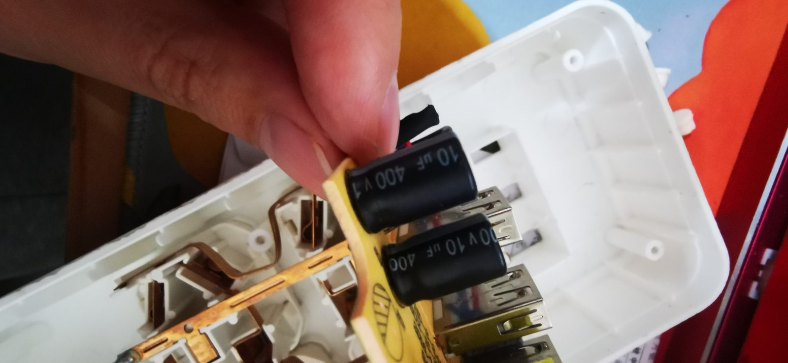

**图 4.2.4 输入端的两颗 10 µF / 400 V 电解电容**

真正的电子元器件全在 USB 那一头：一块开关电源板，加一个变压器和几只电解电容，把 220V 降到 5V。而凸起对应的那块位置底下，只有铜条和塑料，没有会鼓包的电容。

## 5 盖回去之前，看到一片裂开的塑料

### 5.1 就是这块

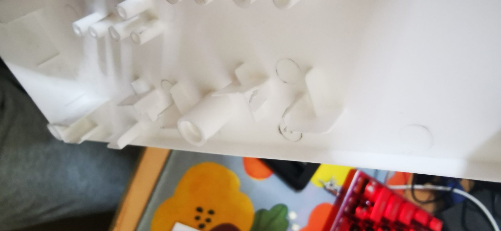

**图 5.1.1 被劈开、外翻的塑料筋**

既然里面没什么问题，就准备装回去了。清灰的时候才注意到这里：底盖内侧有一块塑料片被劈开了，翻起来正好顶住后盖。看形态是定位/加强用的塑料筋，模具设计的位置和高度都不太对，装配的时候直接被压劈，装完之后就一直保持着这个变形状态。

所以底部那块凸起，是这块塑料从里头顶出来的。这只插排从出厂就带着这个毛病。

## 6 结个尾

绕了一圈，那块凸起既不是电池鼓包，也不是电容爆浆，就是装配时被压劈的一片塑料从里头顶出来的。没法治本，把它修平能缓解一点，但顶不顶得住还得看装回去的力。

顺带也摸清了这只插排的防拆套路：两颗三角螺丝裸在外面，另外四颗藏在四只胶帽底下，下回拆同类的东西先看看脚垫，别一上来就硬撬。铜条那边也留个印象，2500W 的标称当不了真，日常充手机、带台灯随便用，真要靠它长期拖大功率电器就别指望了。

安全上倒不用太紧张，这类插排里没有电池，断电之后也没有残留到能电人的电荷；但 USB 那块板子是直接吃市电的，所以拆开之后绝对不要通电试。

然后就是原样装回去：六颗螺丝拧紧，四只胶帽按回原位。凸起还在，但心里不慌了——它不是要坏的前兆，只是这只插排出厂时就带着的一点小毛病。
